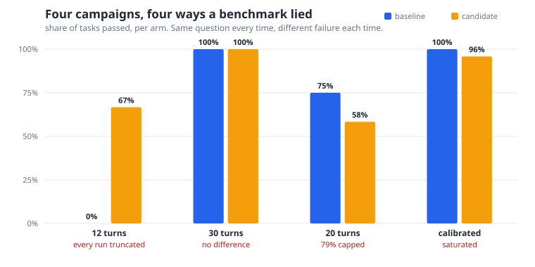
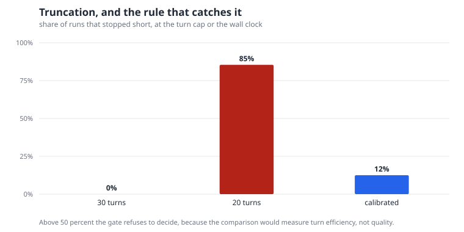
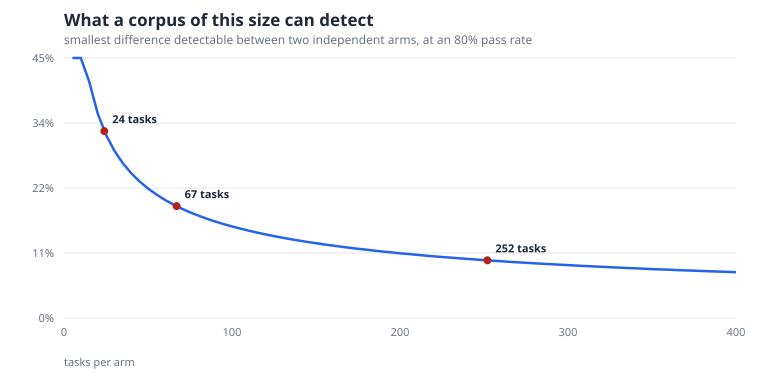

# EVO for AI harnesses

A working bench that measures whether an AI coding harness improves, built on **EVO** (Tom
Gilb's Evolutionary Value Delivery). One claim: code is cheap now, and quantified value,
honest measurement and a budget are the expensive parts.

Site: [evo.aikitchen.cc](https://evo.aikitchen.cc) · Overview: [docs/index.html](docs/index.html)

## Deliverables

| | Delivered |
| --- | --- |
| Working bench | Python package `src/evo_bench`: task mining, sandbox, runner, grader, ledger, statistics, gate, report, cost accounting |
| Task corpus | 67 tasks mined from real `pallets/click` commits, each with a gold patch, all passing gold and null controls |
| Real campaigns | 4 campaigns against a live model, 168 billed runs, **$1.34** total spend |
| Negative results | 4 documented failure modes, each caught by a rule rather than an opinion |
| Interface | CLI (`control`, `run`, `cycle`, `gate`, `report`, `mine`, `calibrate`, `plan`, `estimate`), HTML receipts, CI |
| Safety | bubblewrap sandbox (no network, no home, no keys), path-contained tools, secret scan and pre-commit hook |
| Research | 7 long-form documents in [`mds/`](mds/), from the method to evaluation practice |
| Tests | 157 passing, plus CI running tests, the secret scan and the controls |

## The finding

Four campaigns asked whether a prompt variant makes the agent better. Each failed to answer it
for a different reason:

| Campaign | Baseline | Candidate | What it exposed |
| --- | --- | --- | --- |
| 3 tasks, 12 turns | 0/3 | 2/3 | every run truncated mid tool call |
| 3 tasks, 30 turns | 3/3 | 3/3 | the earlier "win" was the budget |
| 24 tasks, 20 turns | 75% | 58% | 85 percent stopped short, the gate refused to decide |
| 24 tasks, calibrated | 100% | 96% | corpus saturated, nothing left to win |



The first row is the point. A tempting result, a plausible story about stricter prompts, and a
trace showing nothing had finished. The bench now records `exit_reason` so that a run which ran
out of budget cannot be counted as a clean failure, and the gate refuses a comparison when more
than half the runs stopped short.





## How it works

```
tasks -> sandbox -> agent (Tau) -> grader -> ledger -> gate -> report
```

- **Mining.** A commit that changes tests and source becomes a task: the parent tree with the new
  tests overlaid fails, and the source half of the commit makes it pass. Only the tests that flip
  are graded.
- **Sandbox.** The agent loop runs on the host because it needs the model API; tool execution runs
  in bubblewrap with no network, no home directory and no inherited environment.
- **Ledger.** One row per run: tokens, cost, turns, tool calls, exit reason, score.
- **Gate.** Paired exact McNemar, a cost cap, a holdout guard and a truncation guard. It returns
  promote, reject or inconclusive, with reasons.
- **Receipts.** Every campaign produces a self-contained HTML report, and the charts above are
  regenerated from the ledgers by `scripts/charts.py`.

## Run it

```sh
pixi shell                     # evo1 environment
pixi run test                  # 157 tests
pixi run control               # gold passes, null fails, 67 tasks
python -m evo_bench status     # corpus, splits, resolution
python -m evo_bench plan       # what this corpus can resolve
python -m evo_bench estimate --ledger runs/clickfair.jsonl
```

Providers are configuration, not code: `EVO_PROVIDER`, `EVO_MODEL`, `EVO_PROVIDER_KEY` in `.env`,
with presets for OpenRouter, OpenAI, Hugging Face and local models. Keys stay on the host and
never enter the sandbox. `pixi run secrets` checks nothing leaked.

## The documents

| Document | What it covers |
| --- | --- |
| [EVO in software development](mds/evo-sw-devel.md) | the method, Planguage, impact estimation, the ten principles |
| [EVO in the AI harness era](mds/evo-in-ai-era.md) | SWE-EVO, METR horizons, instruction following, token economics |
| [Building a custom AI harness](mds/evo-in-ai-harness.md) | the thirteen layers, component defaults, contracts, budgets |
| [Simulating the process](mds/evo-simulation.md) | scenario corpora, variance, ablation, fault injection |
| [A self-improving harness](mds/evo-rsi-harness.md) | the loop, the three audits, the frozen evaluator rule |
| [Choosing a harness](mds/evo-custom-ai-harness.md) | Tau, JAZ and the Python field, with the Python-only rule |
| [Benchmarking and evaluating](mds/evo-benchmark-evals.md) | instrument quality, contamination, the metrics that survive |

## Limits

- The corpus saturates: the baseline solves all 24 calibrated train tasks, so pass rate cannot
  rank variants on it. Difficulty screening is the next piece of work, tracked in
  [INTENT.md](INTENT.md).
- 24 paired tasks resolve only a large effect. The resolution curve above is the honest statement
  of that, not a footnote.
- One model, one repository, one task type (bug fixes with existing tests).
- Judge or rubric grading for tasks without tests is designed but not built.

## Environment

Python work runs in the isolated pixi workspace `evo1`: Python 3.12, `tau-ai` 0.4.11, pytest, and
the local `evo-bench` package installed editable. `docs/` is hand-written static HTML for GitHub
Pages, with no build step.
